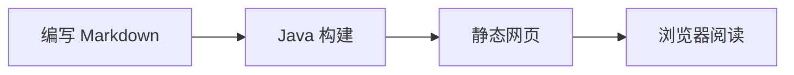
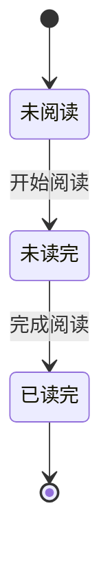

## Java 代码

```java
// 中文注释与 English comments，检查独立中英文字体。
public class Example {
    public static void main(String[] args) {
        String message = "你好，世界！Hello, world!";
        System.out.println(message);
        System.out.println("这是一条故意写得很长的代码，用于观察关闭换行时的横向滚动，以及开启换行时的视觉效果。abcdefghijklmnopqrstuvwxyz0123456789");
    }
}
```

## HTML 代码必须只展示

```html
<details>
  <summary>这只是源码，不应该变成折叠按钮</summary>
  <script>alert('这段脚本不得执行');</script>
</details>
```

```markdown
**这里是代码中的 Markdown 标记，不应渲染成加粗。**
> [!WARNING]
> 这里也只是代码。
```

## 其他代码语言

```sql
SELECT name, age FROM students WHERE age >= 18;
```

```json
{"name": "测试", "enabled": true}
```

## 数学公式

行内公式 $a_b + c^2$，括号形式 \(x_1 + x_2\)。

$$
\frac{a_1+b_2}{c_3} = \sum_{i=1}^{n} i
$$

## Mermaid 流程图



## 关联返回测试

这里是位置 C。点击底部“返回”，应先回到 B，再返回 A。


## 长代码折叠

下面代码超过 18 行，可检查展开／折叠全部长代码开关。

```java
public class LongCodeDemo {
    private final String name;

    public LongCodeDemo(String name) {
        this.name = name;
    }

    public String greeting() {
        return "你好，" + name;
    }

    public int sum(int first, int second) {
        return first + second;
    }

    public void print() {
        System.out.println(greeting());
        System.out.println(sum(3, 5));
    }

    public static void main(String[] args) {
        LongCodeDemo demo = new LongCodeDemo("世界");
        demo.print();
    }
}
```

## 长公式与折叠图表

长公式应在自己的区域内横向滚动，不应撑宽整个页面。

$$
\operatorname{total}(a,b,c,d,e,f,g,h)=a^2+b^2+c^2+d^2+e^2+f^2+g^2+h^2+\sum_{i=1}^{100}\frac{i^2+i+1}{i+1}
$$

<details>
<summary>展开查看状态图</summary>



</details>
